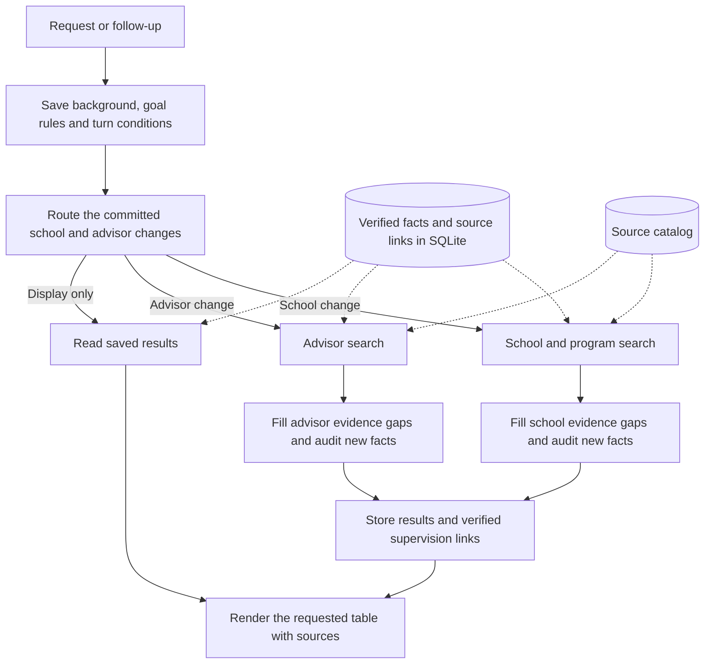

# Graduate Searching Workflow

**English** · [简体中文](README.zh-CN.md) · [Changelog](CHANGELOG.md#changelog-en)

## Description

Find master's and PhD programs, potential supervisors, or both. Refine your requirements over multiple turns. When new evidence is needed, two search agents independently open original sources and a third agent audits their findings. The workflow returns a table with source links in the language of the request.

For example, you can require guaranteed full funding for a PhD while allowing a self-funded master's with total tuition up to CAD 40,000. The two degree levels share a goal but keep their own requirements. A one-turn request such as “only show research-based options this time” applies to that turn.

## Workflow structure



| Stage | What happens |
| --- | --- |
| Intake and storage | Sol 6.1 (`xhigh`) extracts changes. A language check reviews the reply. SQLite stores applicant background per user, persistent rules per goal and temporary conditions per turn. Durable changes are versioned. |
| Planning | Sol 6.1 (`xhigh`) uses the frozen turn and the local source catalog. It returns search directions, priorities, focus and reasons. It can direct researchers to official pages beyond the catalog. |
| Independent research | Two Sol 6.1 (`high`) searches discover candidates. They share candidate identities, then independently open source pages and collect evidence. The workflow distinguishes degree, qualification, track, campus and intake. |
| Audit and publication | Astra 6 (`xhigh`) reopens primary sources. Publication checks require evidence for applicable hard rules and displayed facts. The default model IDs are `gpt-6.1-sol` and `gpt-6-astra`. |

**Master's screening.** Training route and thesis requirement are separate conditions. A tuition cap specifies the currency, billing period, fee category and whether mandatory fees count. An international per-term rate alone cannot establish a whole-program cap. Funding coverage and funding mechanism are also separate, so a competitive award does not establish a guarantee upon admission.

### School and advisor branches

Use the same `turn`, `plan` and `search` commands for program searches, advisor searches and requests for advisor–program pairs. Intake compares each branch’s effective requirements with the previous turn and saves both snapshots and their differences to SQLite. The router reads those differences, changes to open questions and explicit one-turn tasks to select the branches to run. “Find an advisor at UBC” uses UBC as a filter on the advisor. It starts a school search only if the school branch also has work.

When both branches have changes, they run in parallel. A display-only request such as “show the first pair” reads the eligible saved results from SQLite.

Each selected branch checks the user's saved facts before searching. It can read the other branch's records. A verified supervision link identifies the person, program, degree, campus and training pathway. Faculty directories, conference proceedings, scholarly indexes, project registers and thesis repositories help locate evidence. Publishing a new link requires two independent readings and an audit of the sources documenting supervision for that program.

Reuse is field-specific. Recruitment, deadline and status facts have a seven-day window. Current program facts generally have a thirty-day window. Documented mentoring history can be reused across sessions. When a new requirement needs evidence, the branch can keep the known candidate and check the missing fields. Asking for more candidates or an explicit refresh creates a one-turn search task.

### Directories and storage

| Path | Purpose |
| --- | --- |
| [scripts](workflows/phd-opportunity-screening/scripts/) and [prompts](workflows/phd-opportunity-screening/prompts/) | CLI, storage, planning, search, publication and the English-language agent instructions |
| [sources.sqlite3](workflows/phd-opportunity-screening/data/sources.sqlite3) and [sources.sql](workflows/phd-opportunity-screening/data/sources.sql) | Shared source catalog and SQL for building a fresh copy |
| [evals](workflows/phd-opportunity-screening/evals/) | Offline regression tests, a synthetic applicant fixture and separate live checks |
| `runs/workflows/phd-opportunity-screening/goals.sqlite3` | Created locally on the first saved turn. Resume with the same database, user and goal. |
| `runs/test/` | With `--save-test`, stores the plan or detailed search report, including evidence, audit decisions and the published table. Local runs are ignored by Git. |

Applicant data is stored on your machine. Relevant request text, stored rules and background are sent to the configured model during AI stages. Detailed research reports can contain that material.

## Usage

### Setup

Run the commands from the repository root in a **macOS or Linux shell**. On Windows, use WSL with the checkout in the Linux filesystem. Test-report filenames contain a colon. You need Git and **Python 3.9+** with SQLite JSON functions and an IANA time-zone database. The Python code uses the standard library. The repository includes a ready-to-query SQLite source catalog.

```bash
git clone https://github.com/Terreturn/Graduate-Searching-workflow.git
cd Graduate-Searching-workflow
python3 --version
WF=workflows/phd-opportunity-screening
python3 "$WF/scripts/sources.py" --degree master --type program
```

The last command runs offline and prints a JSON list of source directories. Set `WF` again when opening a new shell. The directory name is historical and is used for both degrees.

**For AI-assisted intake, planning and live search**, install Codex CLI, sign in and confirm that your account can access the models listed in the workflow structure table. If you already have Node.js and npm, one installation option is shown here. Other installers are available in the [official Codex CLI guide](https://developers.openai.com/codex/cli/).

```bash
npm install -g @openai/codex
codex --version
codex login
codex login status
```

The CLI must support `codex exec` with `--ephemeral`, `--ignore-user-config`, `--output-schema` and JSON web-tool events. Live research requires network access and live web search. Model access depends on the account and CLI build. If a model or option is unavailable, check your CLI version and model access. The model selections are in [model_call.py](workflows/phd-opportunity-screening/scripts/model_call.py) and [research.py](workflows/phd-opportunity-screening/scripts/research.py).

### First search

Run these steps in order. Keep the same user and goal IDs for follow-up requests.

```bash
# 1. Save the applicant's request. Use a fresh turn ID for each new message.
python3 "$WF/scripts/goals.py" --user demo --goal canada turn --id t01 \
  "Find research-based master's programs in Canada with a required thesis."

# 2. Add a budget for this turn only.
python3 "$WF/scripts/goals.py" --user demo --goal canada turn --id t02 \
  "For this turn only, total international tuition must be at most CAD 40000."

# 3. Inspect the stored modules and preview the search directions.
python3 "$WF/scripts/goals.py" --user demo --goal canada modules --turn t02
python3 "$WF/scripts/goals.py" --user demo --goal canada plan --turn t02

# 4. Search the web, audit the evidence and save a local research report.
python3 "$WF/scripts/goals.py" --user demo --goal canada search --turn t02 --save-test
```

`turn` and `plan` call a model. `modules` reads local storage. `search` generates its own plan, so the preview is optional. The search prints a Markdown table with columns chosen for the question, such as *Program | Institution | Total international tuition | Sources*. It may return fewer rows than requested, no verified matches, or an incomplete-check message if evidence is missing.

### Run the four-turn example

Choose a new SQLite path to run the four-turn example. The runner writes the questions, worker intervals, web calls and answers to `runs/test/`. The last command reads the saved advisor snapshot for turn 3 offline.

```bash
DB=runs/workflows/advisor-demo/goals.sqlite3
python3 -B "$WF/evals/verify_branches.py" --db "$DB"
python3 "$WF/scripts/goals.py" --db "$DB" --user demo --goal ubc results --turn q3 --branch advisor
```

### Run checks and inspect history

To check the installation offline and view a goal's history:

```bash
python3 -B -m unittest discover -s "$WF/evals" -p 'test_*.py'
python3 "$WF/scripts/goals.py" --user demo --goal canada history
```

Use `--db PATH` before a goal subcommand to select a different database. Omit `--turn` on `plan` or `search` to use the latest saved turn. Retrying the same message with the same turn ID reuses the saved intake result. Further command and data-format details are in the [workflow reference (Chinese)](workflows/phd-opportunity-screening/workflow.md).
