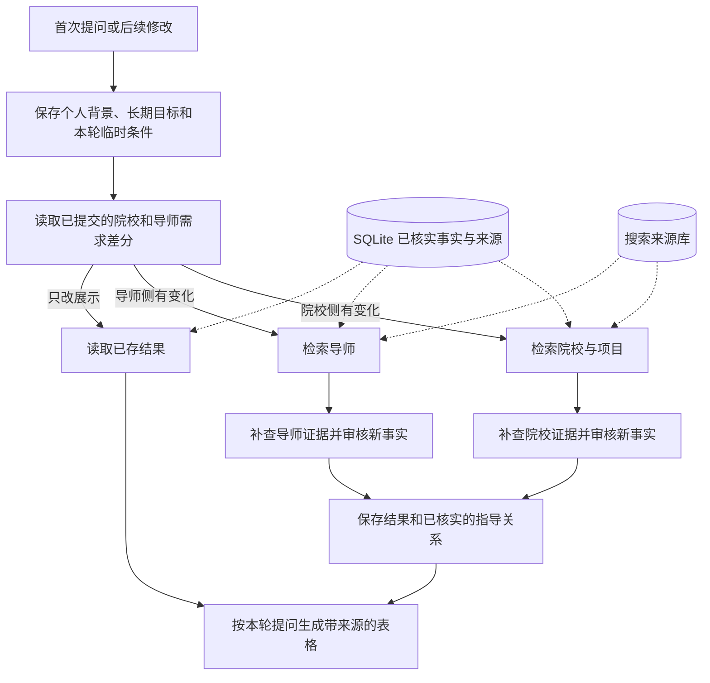

# 硕士与博士项目及导师筛选工作流

[English](README.md) · **简体中文**

**v1.0.0 · 院校与导师筛选**

用自然语言查找硕士和博士项目、潜在导师，或两者的组合，并在后续轮次补充条件。需要新证据时，两位搜索 Agent 独立查阅原始来源，第三位 Agent 审核。工作流按提问语言返回附来源链接的表格。

例如，你可以在同一个目标中要求“博士必须保证全奖，硕士可以自费，但整个项目学费最多 4 万加元”。两种学位分别核对各自的条件。“这次只看研究型项目”只影响当前一轮。

## 安装与设置

以下命令从仓库根目录运行，适用于 **macOS 或 Linux 终端**。Windows 用户可在 WSL 中使用，仓库请放在 Linux 文件系统中，因为测试报告文件名含冒号。需要安装 Git 和 **Python 3.9 或以上版本**，并具备 SQLite JSON 函数与 IANA 时区数据库。Python 代码使用标准库，仓库内已附可直接查询的 SQLite 来源库。

```bash
git clone https://github.com/Terreturn/Graduate-Searching-workflow.git
cd Graduate-Searching-workflow
python3 --version
WF=workflows/phd-opportunity-screening
python3 "$WF/scripts/sources.py" --degree master --type program
```

最后一条命令可离线执行，成功时会打印 JSON 格式的硕士项目检索入口。新开终端后需要重新设置 `WF`。目录名沿用最初的博士工作流，硕士和博士使用同一套入口。

**使用需求拆解、规划或联网搜索时**，还需要安装 Codex CLI、登录，并确保账号能访问下表所列模型。如果已经安装 Node.js 和 npm，可以执行以下命令。其他安装方式见 [Codex CLI 官方指南](https://developers.openai.com/codex/cli/)。

```bash
npm install -g @openai/codex
codex --version
codex login
codex login status
```

CLI 需要支持 `codex exec` 的 `--ephemeral`、`--ignore-user-config`、`--output-schema` 参数，以及 JSON 格式的网页工具事件。实际检索需要联网及实时网页搜索权限。模型可用性取决于账号和 CLI 版本。遇到模型不可用或参数不识别时，先检查版本与权限。默认模型在 [model_call.py](workflows/phd-opportunity-screening/scripts/model_call.py) 和 [research.py](workflows/phd-opportunity-screening/scripts/research.py) 中设置。

## 完成第一次搜索

按顺序执行下列命令。后续追问时，沿用相同的用户 ID 和目标 ID。

```bash
# 1. 保存申请需求，每条新消息使用新的轮次 ID。
python3 "$WF/scripts/goals.py" --user demo --goal canada turn --id t01 \
  "我想找加拿大的研究型硕士项目，必须要求写毕业论文。"

# 2. 添加仅在本轮生效的预算条件。
python3 "$WF/scripts/goals.py" --user demo --goal canada turn --id t02 \
  "仅限本轮，国际生整个项目的学费最多 4 万加元。"

# 3. 查看三个存储模块，预览搜索方向。
python3 "$WF/scripts/goals.py" --user demo --goal canada modules --turn t02
python3 "$WF/scripts/goals.py" --user demo --goal canada plan --turn t02

# 4. 联网查找候选，由审核 Agent 核对证据，同时保存本地报告。
python3 "$WF/scripts/goals.py" --user demo --goal canada search --turn t02 --save-test
```

`turn` 和 `plan` 会调用模型。`modules` 只读取本地数据。`search` 会自行生成搜索计划，因此可以跳过预览。终端最终显示 Markdown 表格，按提问选择列，例如“项目｜院校｜国际生全项目学费｜来源”。满足条件的项目较少时按实际数量展示；没有通过审核的条目或核查受阻时，表格会说明状态。

## 整体工作流



| 阶段 | 处理内容 |
| --- | --- |
| 需求拆解与存储 | Sol 6.1（`xhigh`）提取本轮变化，再核对回显语言。SQLite 按用户保存个人背景，按目标保存长期规则，按轮次保存临时条件。长期目标的变化带版本号。 |
| 搜索规划 | Sol 6.1（`xhigh`）根据该轮已存条件和本地来源库给出搜索方向、优先级、搜索重点和排序理由，也可指定需要进一步定位的官方页面。 |
| 独立检索 | 两个 Sol 6.1（`high`）独立发现候选，交换候选身份后分别打开原文取证。系统区分学位层级、正式学位名称、培养方向、校区和入学批次。 |
| 审核与输出 | Astra 6（`xhigh`）回读原始页面。发布器核对硬条件与展示字段的证据。默认模型 ID 为 `gpt-6.1-sol` 和 `gpt-6-astra`。 |

**硕士筛选。** 培养路径与论文要求分别记录。学费上限同时记录币种、计费周期、学生收费类别及是否包含强制费用。只有国际生每学期费率时，还需取得整个项目的修读依据才能判断是否在总预算内。资助覆盖范围和获得方式也分别核实，例如“可竞争全奖”不能证明“录取即保证全奖”。

## v1.0.0 的院校与导师查询

查项目、查导师或查导师与项目组合，都使用同一套 `turn`、`plan` 和 `search` 命令。拆解模块先按分支比较本轮与上轮的生效条件，把两侧的快照和差分写入 SQLite。路由读取已提交的差分、待澄清问题的变化和明确的一次性任务，再决定启动哪些分支。例如，“找 UBC 的导师”会把 UBC 记为导师的筛选条件。院校侧也有任务时，才会启动院校搜索。

2026-11-20 的真实验收在同一个 UBC 搜索目标下连续提了四个问题。

| 轮次 | 申请人要求 | 实际启动的分支 | 结果 |
| --- | --- | --- | --- |
| 1 | 查 UBC 温哥华校区统计学硕士及其官网。 | 仅院校 | 保存项目和校区。 |
| 2 | 查 Paul Gustafson 的研究方向，并关联上轮硕士项目。 | 仅导师 | 复用已有项目，核实导师与该项目论文路径的关联。 |
| 3 | 项目要允许写硕士论文，导师要有公开的研究生论文指导记录。 | 院校与导师并行 | 两条分支的执行时间重叠，同一组合通过两项核查。 |
| 4 | 只展示第一组已核实结果。 | 均未启动 | 从 SQLite 读取同一组合和来源，**网页调用为零**。 |

每条启动的分支先检查当前用户已核实的事实，也可以读取另一侧已有的记录。存储的指导关系具体到导师、项目、学位、校区和培养路径。院系名录、会议论文集、学术索引、科研项目库和学位论文库可用于定位证据。发布新的指导关系前，两位检索者独立取证，审核者回读能直接证明该导师可指导这一项目的来源。

复用按字段判断。招生、截止日期和开放状态的复用窗口为七天，一般项目事实为三十天，已核实的过往指导经历可跨会话复用。新增条件需要证据时，分支可以沿用原候选，只补查缺失字段。明确要求“再找几位”或“重新核实”会生成一次性搜索任务。

**版本测试。** 56 项离线回归测试全部通过，四轮真实验收全部通过，其中一次补查复用了先前的取证记录。重新打开 SQLite 后，第三、第四轮复现出的组合、来源和表格完全一致。以下命令用新的数据库路径重跑真实验收，把提问、数据库差分、分支实际执行区间、网页调用和回答写入 `runs/test/`。最后一条命令可离线查看第三轮保存的导师记录。

```bash
DB=runs/workflows/advisor-demo/goals.sqlite3
python3 -B "$WF/evals/verify_branches.py" --db "$DB"
python3 "$WF/scripts/goals.py" --db "$DB" --user demo --goal ubc results --turn q3 --branch advisor
```

## 筛选流程更新 · 2026-11-17

待澄清的硬条件会按目标、学位和国家保存，直到用户补全或撤回。每轮保留当时的快照。例如，硕士学费上限为 40,000，但币种和计费周期待确认时，系统可以继续找项目，只暂缓发布受影响的硕士结果。已核实的 PhD 项目仍可展示。

遇到限定国家的规则时，两位检索者和审核者都要核实授课校区所在国。最终表格使用三方确认的学费、津贴金额和截止日期，并附上展示内容对应的来源链接。

42 个离线回归测试全部通过。另用真实拆解模型测试了三轮，确认变更专业偏好后，硕士预算问题仍会保留，补全币种和计费周期后预算上限生效。

## 数据、报告与检查

| 路径 | 用途 |
| --- | --- |
| [scripts](workflows/phd-opportunity-screening/scripts/) 和 [prompts](workflows/phd-opportunity-screening/prompts/) | 命令入口、存储、规划、搜索、发布代码，以及英文 Agent 提示词 |
| [sources.sqlite3](workflows/phd-opportunity-screening/data/sources.sqlite3) 和 [sources.sql](workflows/phd-opportunity-screening/data/sources.sql) | 共用检索来源库与新建该库所需的 SQL |
| [evals](workflows/phd-opportunity-screening/evals/) | 离线回归测试、合成申请人样例，以及独立的联网检查 |
| `runs/workflows/phd-opportunity-screening/goals.sqlite3` | 首次保存轮次时在本地创建。用相同数据库、用户 ID 和目标 ID 可继续上次的搜索。 |
| `runs/test/` | 加上 `--save-test` 时保存规划或详细研究报告，含取证、审核与最终表格。Git 忽略本地运行目录。 |

申请人数据存储在本机。调用模型的阶段会将相关提问、已存规则和背景传给所配置的模型；详细研究报告也可能包含这些内容。

以下命令用于离线检查安装和查看已存目标的历史。

```bash
python3 -B -m unittest discover -s "$WF/evals" -p 'test_*.py'
python3 "$WF/scripts/goals.py" --user demo --goal canada history
```

需要切换数据库时，在目标子命令之前加 `--db 路径`。`plan` 和 `search` 省略 `--turn` 时读取最新轮次。以相同 ID 重试同一条消息会复用已保存的拆解结果。更多命令、数据字段与角色说明见[工作流参考文档](workflows/phd-opportunity-screening/workflow.md)。
